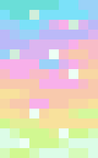

<!DOCTYPE html>  <html lang="en">  
<head>  
<meta charset="UTF-8">  
<meta name="viewport" content="width=device-width, initial-scale=1.0">  
<meta name="theme-color" content="#080b12">  
<title>MC STORE | Minecraft Cape Shop</title>    </head>  <body>  
  
  
  
    IN STOCK: BUILDER ✦ AURORA ✦ CORRUPTED CAPES  
    OTHER CAPES: NOT IN STOCK  
    QUESTIONS? JOIN OUR DISCORD  
    IN STOCK: BUILDER ✦ AURORA ✦ CORRUPTED CAPES  
    OTHER CAPES: NOT IN STOCK  
    QUESTIONS? JOIN OUR DISCORD  
  
  

  <nav>  
    
  
  
    <a href="#home">Home</a>  
    <a href="#shop">Capes</a>  
    <a class="btn" href="#shop">Shop Now ↗</a>  
  
  
</nav>  <header class="hero" id="home">  
  THE MC STORE COLLECTION  
  <h1>Discover Minecraft Capes.</h1>  
  
  
    Builder, Aurora, and Corrupted Capes are currently in stock.  
    All other capes are not in stock. Contact our team on Discord  
    to order or ask about restocks.  
  
    
  
    <a class="btn" href="#shop">Explore Collection ↗</a>  
    <a class="btn btn-secondary"  
       href="https://discord.com/invite/F38vcYVHA"  
       target="_blank" rel="noopener noreferrer">Join Discord ↗</a>  
  
    
  
    
<strong>MC STORE</strong>Your cape destination
  
    
<strong>Exclusive</strong>Minecraft capes
  
    
<strong>Community</strong>Discord support
  
  
  
</header>  <section id="shop">  
  
  
    
  
      
OUR COLLECTION
  
      <h2>Featured Capes</h2>  
      
  
        Currently in stock: Builder Cape, Aurora Cape, and Corrupted Cape.  
        All other capes are not in stock.  
      
  
    
  
    <a class="btn" href="https://discord.com/invite/F38vcYVHA"  
       target="_blank" rel="noopener noreferrer">Ask About Stock ↗</a>  
  
    
  <!-- 1. CORRUPTED CAPE -->  
<article class="card">  
  
  
    IN STOCK  
      
  
  
  
  
    <h3>Corrupted Cape</h3>  
    
A distinctive cape for your Minecraft collection.
  
    
  
      
Contact us<small>For current price</small>
  
      <a class="btn order" href="https://discord.com/invite/F38vcYVHA"  
         target="_blank" rel="noopener noreferrer">BUY NOW ↗</a>  
    
  
  
  
</article>  

<!-- 2. AURORA CAPE -->  
<article class="card">  
  
  
    IN STOCK  
      
  
  
  
  
    <h3>Aurora Cape</h3>  
    
A vibrant cape for players who want to stand out.
  
    
  
      
Contact us<small>For current price</small>
  
      <a class="btn order" href="https://discord.com/invite/F38vcYVHA"  
         target="_blank" rel="noopener noreferrer">BUY NOW ↗</a>  
    
  
  
  
</article>  

<!-- 3. BUILDER CAPE -->  
<article class="card">  
  
  
    IN STOCK  
      
  
  
  
  
    <h3>Builder Cape</h3>  
    
A classic addition for Minecraft cape collectors.
  
    
  
      
Contact us<small>For current price</small>
  
      <a class="btn order" href="https://discord.com/invite/F38vcYVHA"  
         target="_blank" rel="noopener noreferrer">BUY NOW ↗</a>  
    
  
  
  
</article>  

<!-- 4. EXPERIENCE CAPE -->  
<article class="card">  
  
  
    NOT IN STOCK  
      
  
  
  
  
    <h3>Experience Cape</h3>  
    
A special cape to add to your Minecraft collection.
  
    
  
      
Not in stock<small>Currently unavailable</small>
  
    
  
  
  
</article>  

<!-- 5. CRAFTER CAPE -->  
<article class="card">  
  
  
    NOT IN STOCK  
      
  
  
  
  
    <h3>Crafter Cape</h3>  
    
A distinctive cape for Minecraft fans and collectors.
  
    
  
      
Not in stock<small>Currently unavailable</small>
  
    
  
  
  
</article>  

<!-- 6. MENACE CAPE -->  
<article class="card">  
  
  
    NOT IN STOCK  
      
  
  
  
  
    <h3>Menace Cape</h3>  
    
A striking cape for your Minecraft collection.
  
    
  
      
Not in stock<small>Currently unavailable</small>
  
    
  
  
  
</article>  

<!-- 7. COPPER CAPE -->  
<article class="card">  
  
  
    NOT IN STOCK  
      
  
  
  
  
    <h3>Copper Cape</h3>  
    
A copper-themed cape for Minecraft players.
  
    
  
      
Not in stock<small>Currently unavailable</small>
  
    
  
  
  
</article>  

<!-- 8. MOONLIGHT CAPE -->  
<article class="card">  
  
  
    NOT IN STOCK  
      
  
  
  
  
    <h3>Moonlight Cape</h3>  
    
A moonlight-inspired cape for your Minecraft collection.
  
    
  
      
Not in stock<small>Currently unavailable</small>
  
    
  
  
  
</article>  

<!-- 9. PURPLE HEART CAPE -->  
<article class="card">  
  
  
    NOT IN STOCK  
      
  
  
  
  
    <h3>Purple Heart Cape</h3>  
    
A purple-themed cape to add to your Minecraft collection.
  
    
  
      
Not in stock<small>Currently unavailable</small>
  
    
  
  
  
</article>

  
  
</section>  
  
  
NEED HELP?
  
  <h2>Join the MC STORE Discord</h2>  
  
  
    Have a question about an available cape or a future restock?  
    Join our Discord community to contact us.  
  
  
  <a class="btn" href="https://discord.com/invite/F38vcYVHA"  
     target="_blank" rel="noopener noreferrer">Join Discord ↗</a>  

  <footer>  
  © 2026 MC STORE. All rights reserved.  
  Independent community shop. Not affiliated with Mojang or Microsoft.  
</footer>    </body>  
  </html>
